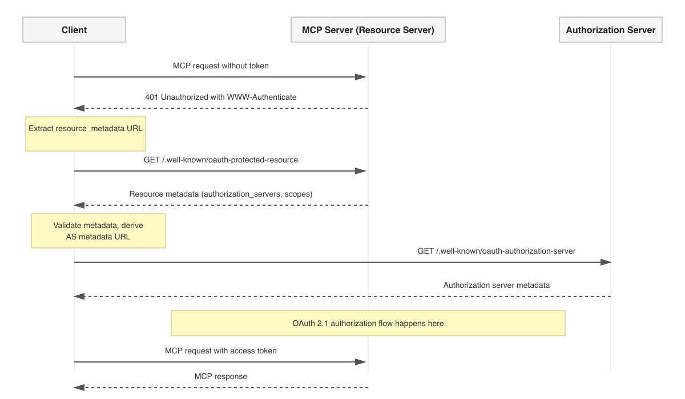
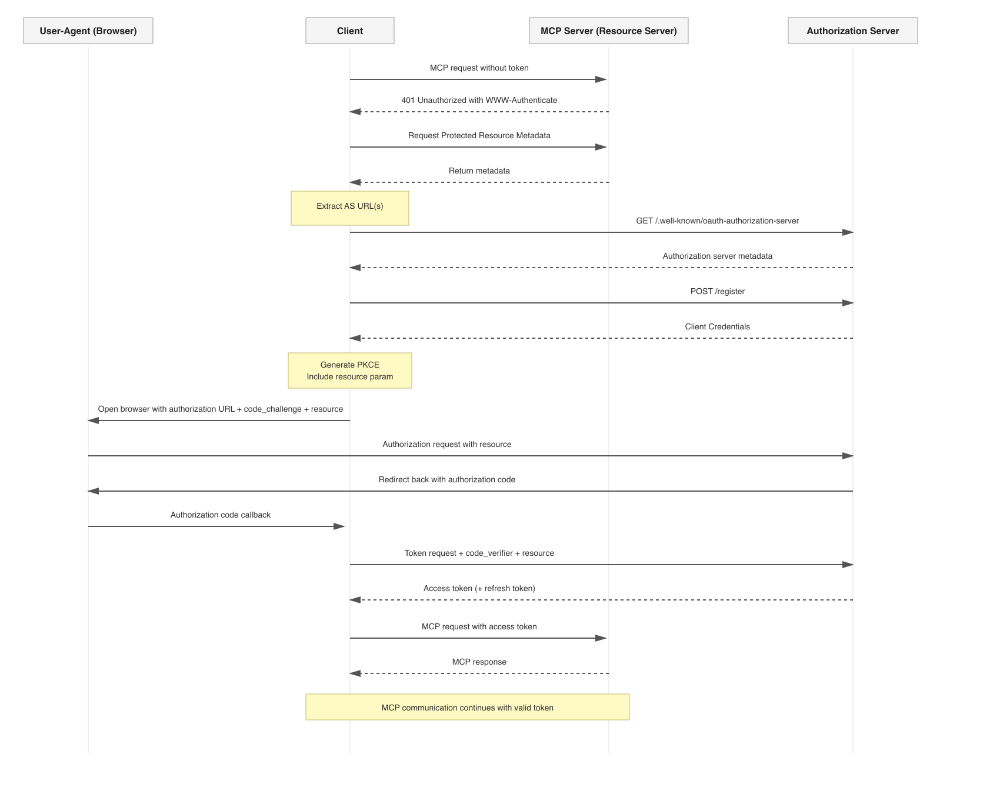

# Authorization and Dynamic Client Registration

This document explains how the Solesonic MCP Server implements the Model Context Protocol (MCP) Authorization flow and Dynamic Client Registration as described in the MCP Basic Authorization specification (2025-06-18):

- Spec link: https://modelcontextprotocol.io/specification/2025-06-18/basic/authorization

The server is implemented as an OAuth 2.0 Resource Server that accepts JWTs and challenges unauthenticated requests with a discoverable `WWW-Authenticate` header that points to its protected-resource metadata at `/.well-known/oauth-protected-resource`. That metadata advertises the authorization server(s) and scopes supported, enabling Dynamic Client Registration (DCR) and token acquisition by clients.


## Summary of how this implementation meets the MCP Authorization spec

- OAuth2 Resource Server with JWT validation:
  - Code: `MpcSecurityConfig.securityFilterChain()` and `jwtDecoder()`.
  - Uses `JwtDecoder` (Nimbus) wired via `spring.security.oauth2.resourceserver.jwt.jwk-set-uri` or issuer configuration.
  - Converts authorities from three sources: `scope` (prefixed `SCOPE_`), `groups` → `GROUP_*`, `roles` → `ROLE_*`.
- Access to individual tools is decided by roles, not scopes:
  - Every `@McpTool` method carries `@PreAuthorize("hasAuthority('ROLE_MCP-...')")`. There is no global scope requirement on `/mcp` (see "Scopes, groups, and roles" below).
- Standards-compliant 401 challenge with discovery pointer (RFC 9728):
  - On unauthorized access, returns 401 with `WWW-Authenticate: Bearer resource_metadata="<resource-base>/.well-known/oauth-protected-resource", scope="<scopes>"`.
  - Code: `MpcSecurityConfig.authenticationEntryPoint()`.
  - CORS allows the `WWW-Authenticate` header so browsers/clients can read it (`MpcSecurityConfig.ALLOWED_HEADERS`).
- Protected Resource Metadata endpoint (well-known):
  - Path: `/.well-known/oauth-protected-resource`.
  - Served by Spring Security's built-in protected resource metadata filter, configured in the `.protectedResourceMetadata(...)` block of `MpcSecurityConfig.securityFilterChain()`. There is no controller.
  - Returns:
    - `resource` → derived from the request's base URL.
    - `authorization_servers` → the configured `issuer-uri`.
    - `scopes_supported` → `solesonic.mcp.scopes`.
    - `bearer_methods_supported`, `tls_client_certificate_bound_access_tokens` → Spring Security defaults.
- CORS and preflight support for HTTP transport (JSON-RPC over HTTP):
  - Allows methods `GET`, `POST`, `OPTIONS`; permits preflight for `/mcp/**` and well-known endpoint.
  - Code: `MpcSecurityConfig.securityFilterChain()` and `corsConfigurationSource()`.


## Key endpoints and headers

- MCP endpoint (HTTP transport): `POST /mcp`
- Well-known resource metadata: `GET /.well-known/oauth-protected-resource`
- 401 Challenge header (unauthenticated request to a protected endpoint):
  - `WWW-Authenticate: Bearer resource_metadata="<resource-base>/.well-known/oauth-protected-resource", scope="<scopes>"`

`<resource-base>` is taken from `solesonic.mcp.resource` and `<scopes>` is `solesonic.mcp.scopes` joined with spaces (see Configuration section). MCP clients request the scopes in `scope`, falling back to `scopes_supported` from the metadata.


## Authorization flow (high level)

1) Client attempts to call the MCP endpoint without a valid token.
2) Server responds with HTTP 401 and a `WWW-Authenticate` header pointing to the well-known metadata.
3) Client fetches `/.well-known/oauth-protected-resource` to discover the Authorization Server and scopes.
4) Client performs Dynamic Client Registration (if not already registered) with the Authorization Server it discovered.
5) Client obtains an access token (authorization code + PKCE) requesting the advertised scopes. The token must carry a `roles` claim with the caller's `mcp-*` roles.
6) Client calls the MCP endpoint again with `Authorization: Bearer <access_token>` and succeeds if the token is valid and authorized.


### Sequence diagram: Authorization challenge + discovery + token use


## Dynamic Client Registration (DCR)

This server supports DCR indirectly by advertising the protected resource metadata—specifically the `resource` identifier and the `authorization_servers`—that a client needs in order to register with the AS. The registration itself is performed with the Authorization Server, not by this resource server.

- Metadata for DCR is exposed at `/.well-known/oauth-protected-resource`.
- The `authorization_servers` array includes the configured OIDC issuer URI (e.g., Cognito, Okta, Keycloak).
- Clients should consult the issuer’s OIDC configuration to locate its Dynamic Client Registration endpoint and register there.

### Keycloak setup for anonymous DCR (realm `solesonic-ai`)

MCP clients such as opencode register anonymously (no initial access token), so Keycloak's **anonymous access policies** apply (Clients → Client registration). Settings required for a registered client to work against this server:

- **Trusted Hosts:** trusted hosts `127.0.0.1` and `localhost`; "Host sending client registration request must match" **off** (registrations come from developer machines with changing IPs); "Client URIs must match" **on**, which limits registered redirect URIs to loopback.
- **Allowed Client Scopes:** "Allow default scopes" on. Every scope in `solesonic.mcp.scopes` is a realm default scope, so no extra entries are needed. Never allow `offline_access` or `token-exchange` here.
- **Consent Required, Full Scope Disabled, Max Clients Limit:** left at their defaults (on, on, 200).
- **`mcp-roles` client scope (realm default):** a *User Client Role* mapper for client `solesonic-llm-ui` writing the multivalued `roles` claim to the access token, plus a scope mapping for every `solesonic-llm-ui` `mcp-*` role. Because Full Scope Disabled applies to registered clients, roles only reach their tokens through this scope mapping. The `token-claims` scope is not used for this, because it also hard-codes `azp=solesonic-llm-ui`.
- **`solesonic-mcp-audience` (realm default):** adds the `solesonic-mcp` audience.
- **PKCE:** realm client policy `public-clients-pkce` (condition `client-access-type` = public) applies the `pkce-s256` profile (`pkce-enforcer` executor, auto-configure on), so registered clients cannot use `plain`.

Loopback redirect URIs are the standard pattern for native clients (RFC 8252 §7.3): the authorization code can only be delivered to the machine doing the login, and PKCE makes an intercepted code useless.

### Sequence diagram: Dynamic Client Registration



## Example: Unauthorized request and discovery

- Unauthorized request to `/mcp`:

```
curl -i -X POST \
  -H 'Content-Type: application/json' \
  http://localhost:8080/mcp
```

Example response (abbreviated):

```
HTTP/1.1 401 Unauthorized
WWW-Authenticate: Bearer resource_metadata="https://api.your-domain.example/.well-known/oauth-protected-resource", scope="openid profile email roles solesonic-mcp-audience mcp-roles"
Content-Type: application/json
```

- Discover metadata:

```
curl -s http://localhost:8080/.well-known/oauth-protected-resource | jq .
```

Example JSON response:

```
{
  "resource": "https://api.your-domain.example",
  "bearer_methods_supported": ["header"],
  "tls_client_certificate_bound_access_tokens": true,
  "authorization_servers": [
    "https://auth.your-domain.example/realms/<realm>"
  ],
  "scopes_supported": [
    "openid",
    "profile",
    "email",
    "roles",
    "solesonic-mcp-audience",
    "mcp-roles"
  ]
}
```


## Example: Authorized request

Once your client is registered with the AS and has obtained a token containing the required scope(s):

```
curl -i -X POST \
  -H 'Authorization: Bearer <ACCESS_TOKEN>' \
  -H 'Content-Type: application/json' \
  http://localhost:8080/mcp \
  -d '{"jsonrpc":"2.0","id":"1","method":"ping","params":{}}'
```

Any valid token from the configured issuer is accepted at `/mcp`; each tool then requires its `ROLE_MCP-*` authority.


## Configuration

These properties are used to control the authorization and discovery behavior. They can be set in `application.properties` or via environment variables (Spring Dotenv loads `.env`; OS env vars override):

- `spring.security.oauth2.resourceserver.jwt.issuer-uri=${ISSUER_URI}`
  - The OIDC issuer URI for the Authorization Server (e.g., Cognito, Okta, Keycloak). Also used in the well-known metadata `authorization_servers`.
- `spring.security.oauth2.resourceserver.jwt.jwk-set-uri` (optional)
  - Direct JWKS URI for token verification (when not using issuer discovery). If set, used by the `JwtDecoder`.
- `solesonic.mcp.resource`
  - The base resource identifier (e.g., `https://api.your-domain.example`).
  - Used in `WWW-Authenticate` as `resource_metadata="<resource>/.well-known/oauth-protected-resource"`.
- `solesonic.mcp.scopes`
  - Comma-separated scopes advertised as `scopes_supported` in the metadata and as `scope` in the 401 challenge. MCP clients request exactly these, so each must be a client scope a dynamically registered client may use (see "Keycloak setup for anonymous DCR").
- `cors.allowed.origins`
  - Origins permitted for browser-based clients.

Related configuration and code references:

- Security configuration and resource metadata: `src/main/java/com/solesonic/mcp/security/MpcSecurityConfig.java`
- Authorities extraction (groups/roles): `src/main/java/com/solesonic/mcp/security/AuthoritiesService.java`


## Scopes, groups, and roles

- Scopes: The JWT `scope` claim is converted to Spring authorities with prefix `SCOPE_` (e.g. `email` becomes `SCOPE_email`). No tool currently checks a scope authority.
- Groups: If a token includes a `groups` claim, each value becomes `GROUP_<NAME>` authority.
- Roles: If a token includes a `roles` claim, each value becomes `ROLE_<NAME>` authority.

This allows fine-grained access control in addition to scope checks. Ensure your Authorization Server issues the appropriate claims.

Tool roles currently enforced: `ROLE_MCP-JIRA-CREATE`, `ROLE_MCP-JIRA-GET`, `ROLE_MCP-JIRA-DELETE`,
`ROLE_MCP-JIRA-AGILE-LIST`, `ROLE_MCP-GMAIL-LIST`, `ROLE_MCP-XERO`,
`ROLE_MCP-WEB-SEARCH`, `ROLE_MCP-GENERATE-IMAGE`, `ROLE_MCP-TIME`, `ROLE_MCP-GET-WEATHER`. A `roles`
claim entry of `mcp-gmail-list` becomes `ROLE_MCP-GMAIL-LIST`, so roles are defined in the identity
provider, not here.

`ROLE_MCP-GMAIL-LIST` covers message *content*, not just listing: it also guards
`get_gmail_message_body`, which returns a message's full body text. Granting it therefore gives read
access to the caller's mail, and not only to subjects, senders and dates.

`ROLE_MCP-XERO` guards `convert_email_to_xero_proposal`, which is currently a mocked
tool — no real Xero account is contacted. It still requires this role and a connected Google account
(see below) because it reads the referenced email through the same Gmail plumbing the other Gmail
tools use.

Beyond the caller's own roles, the Gmail tools additionally require that **this server's** service
account — the client behind the `atlassian-token-broker` client-credentials registration — holds the
`token-mint-gmail` role, since that is what solesonic-llm-api's `POST /broker/google/token` checks.
That is separate from the caller's token and is a common cause of a Gmail tool failing for a caller
whose own roles are correct.


## CORS and browsers

To facilitate browser-based clients discovering the metadata and reading the challenge header:

- CORS allows methods: `GET`, `POST`, `OPTIONS`.
- Allowed headers include `WWW-Authenticate`, `Authorization`, and `Content-Type`.
- Preflight requests to `/mcp/**` and the well-known endpoint are permitted.

Code references:
- `MpcSecurityConfig.corsConfigurationSource()` and `securityFilterChain()`.


## Security considerations

- Only trusted Authorization Servers should be listed in `authorization_servers`.
- Use TLS in production. See `application-ssl.properties` for example SSL configuration.
- Do not log or expose tokens. This project uses SLF4J logging and avoids printing secrets.
- Audience and scope enforcement should be configured in your Authorization Server (e.g., audience `api://solesonic-mcp`) and reflected in tokens issued to clients.


## FAQ

- Q: Does the resource server handle the client registration itself?
  - A: No. It exposes the protected-resource metadata required for clients to locate the Authorization Server and complete Dynamic Client Registration with that server.

- Q: What is the minimal scope required?
  - A: None is checked at `/mcp`. What matters is the `roles` claim, which in Keycloak comes from the `mcp-roles` (or `token-claims`) client scope. List the scopes clients should request in `solesonic.mcp.scopes`.

- Q: How do I change the displayed issuer or scopes in the metadata?
  - A: Set `ISSUER_URI` and `solesonic.mcp.scopes` in your environment or properties files. The metadata `resource` is derived from the request URL; `solesonic.mcp.resource` sets the base URL used in the 401 challenge.
